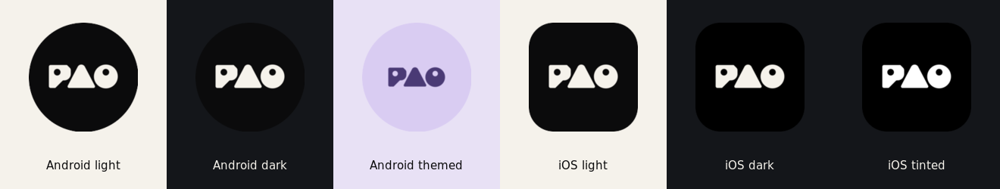
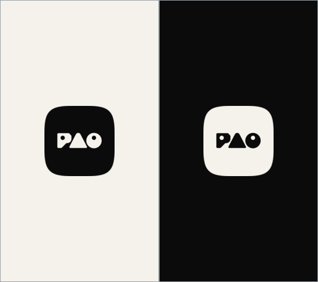
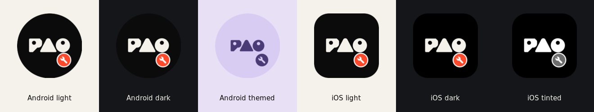

# Brand in the apps

Where the PAO logo, palette, type, illustrations, icons and splash screens come from, how to
regenerate them, and what they look like. Screenshots of every main screen are in
[`docs/screenshots/`](../screenshots/README.md). The sources are in `design/brand/`; the palette and type are in
[ADR-0038](../adr/0038-navy-trust-palette-neutral-type-light-default.md).

## In the app

| What | Code |
|---|---|
| Logo tile and wordmark, ink on light and ivory on dark | `PaoLogo` in `Frontend/packages/pao_ui/lib/src/widgets/logo.dart` |
| Receipt watermark (6% opacity, ivory on dark) | `PaoWatermark`, same file |
| Receipt header logo, watermark and the "Ask for it. PAO it." footer | `Frontend/apps/customer/lib/features/bookings/presentation/receipt_page.dart`, `…/bookings/data/receipt_pdf.dart`, `Frontend/apps/partner/lib/features/jobs/presentation/receipt_sheet.dart` |
| The SVGs the apps ship | `Frontend/packages/pao_ui/assets/brand/` |

## Palette and type

- **Accent:** navy by default (ADR-0038); the admin can pick one of the eleven `AccentPreset`s,
  each with `tint`, `soft`, `primary`, `strong` and `deep`. Text on the accent is always white.
- **Neutrals:** warm paper in light mode (`#F6F4EC` page, the splash colour), navy ink in dark
  mode (`#0E1322`). Every colour comes from `context.pao`; never write a hex value in a screen.
- **Type:** Inter for Latin and Noto Sans Bengali for Bangla and ৳, both shipped in `pao_ui`
  (`PaoFonts`), the system font on iOS. One scale (`paoTextTheme`): screen titles `titleLarge`,
  section headings `titleMedium`, body `bodyMedium`, captions `bodySmall`, money in
  `PaoMoneyText` with tabular digits.
- **Shape and space:** the 4-pt grid (`PaoSpace`), even corners (`PaoShape`), one primary
  button per screen, tap targets at least 48 dp.

## Illustrations

One line style, drawn by `design/illustrations/draw.py` and `scenes.py`, which write the SVGs to
`Backend/database/seed/artwork/` and `Frontend/packages/pao_ui/assets/artwork/`. The admin can
replace any slot (Settings › Appearance › Illustrations); the apps fall back to these.

| Slot | Canvas | Shown |
|---|---|---|
| `customer.signin.hero`, `partner.signin.hero` | 1170 × 1200 | sign-in, top 55% |
| `customer.onboarding.1–3`, `partner.onboarding.1–3` | 1170 × 1080 | onboarding slides |
| `admin.login.hero` | 1600 × 1200 | admin sign-in |
| `empty.bookings`, `empty.jobs`, `empty.notifications`, `empty.search`, `offline` | 720 × 540 | empty and offline states |
| `success.booking`, `success.job` | 720 × 720 | success screens, with `PaoSuccessMark` under them |

Keep the top-left of hero art clear for the wordmark; draw on the navy band so both themes
match.

## Icons

- **Service icons:** 40 line icons in `Frontend/packages/pao_ui/assets/icons/`, 24 × 24 view
  box, 1.75 stroke, round caps and joins, `currentColor` only, so the theme tints them. The
  admin picks one per category or service (or uploads an SVG that follows the same rules).
- **UI icons:** Material outlined icons at 24 dp (20 dp inside buttons); never mix filled and
  outlined in one row.
- **Logo:** never recoloured with the accent and never set in a font.

## Motion

The tokens and transitions are in [motion.md](motion.md).

## Icons and splash screens

The launcher icons and splash screens are generated files. Don't edit them by hand; change the
source in `design/brand/` and run:

```bash
tools/brand/app-icons.sh
```

```bash
tools/brand/splash.sh
```

```bash
tools/brand/preview.sh
```

The scripts need ImageMagick and `rsvg-convert` (`apt install imagemagick librsvg2-bin`).
`preview.sh` redraws the pictures on this page from the generated files.

The partner app's icon has an orange wrench badge so the two apps can't be mixed up on a phone.
Its badge sources are in `design/brand/app-icons/partner/`.

### Customer (PAO)





### Partner (PAO Partner)




These pictures are drawn from the generated files, not taken on a phone. Check a real install
before a release: on Android, the light and dark home screens and themed icons (Settings ›
Wallpaper & style › Themed icons); on iOS, the light, dark and tinted home screens (long-press the
home screen › Edit › Customize).

## Release files

The two apps' release files, CI artifacts and launcher names are listed in
[release.md](release.md#telling-the-two-apps-apart).
